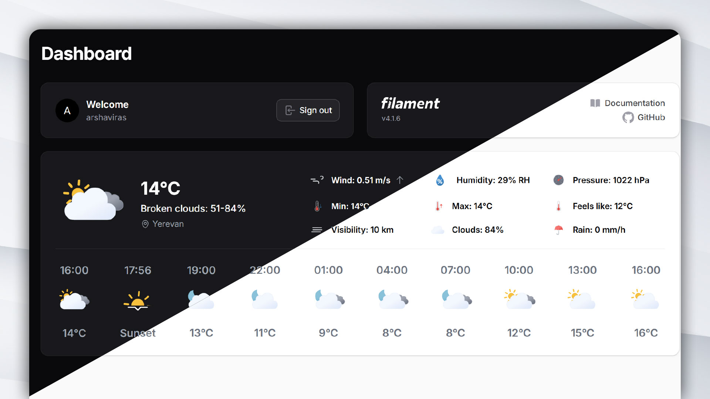

# Weather Widget



A beautiful, configurable **weather widget** for your Filament dashboard.  
Powered by the OpenWeatherMap API, fully translatable, and supports °C/°F, animated Weather Icons, and optional response caching.

## Features

- 🌤️ Current weather, **hourly** and **daily** forecast, with chance of precipitation
- 📍 Search **any place** or use the browser's location
- ⚙️ Per-user settings window (location, units, refresh interval, icons, width)
- ➕ Users can add (duplicate) and remove their own weather cards
- 🧩 Several widgets on one dashboard, each with its own city and options
- 🔁 Auto-refresh at a configurable interval
- ☁️ **Metric**, **imperial** and **standard** units (°C/°F/K, m/s or mph, hPa or inHg, km or mi)
- 🌍 Multi-language support
- 🧠 Response caching (prevents exceeding API rate limits)
- 🎨 Supports 3 icon styles: **Monochrome**, **Line**, and **Fill**
- 🔄 Supports **static and animated** icon variants

## Requirements

- PHP 8.2 or higher
- Laravel 12.x or 13.x
- Filament 4.x or 5.x

Using Laravel 11? Stay on version 1.x of this package.

## Installation

You can install the package via composer:

```bash
composer require arshaviras/weather-widget
```

## Setup

### 1. Register the Widget

Add the widget to your Filament panel configuration:

```php
use Arshaviras\WeatherWidget\Widgets\WeatherWidget;
use Filament\Panel;

public function panel(Panel $panel): Panel
{
    return $panel
        // ... other configuration
        ->widgets([
                //...
                WeatherWidget::class,
            ])
}
```

### 2. Configuration

Publish the config file:

```bash
php artisan vendor:publish --tag="weather-widget-config"
```

This is the contents of the published config file:

```php
return [

    /**
     * API Key for Current Weather Data
     * You can get your API key from OpenWeatherMap:
     * https://openweathermap.org/price
     */
    'api_key' => env('OPENWEATHER_API_KEY', ''),


    /**
     * Default city for weather data
     */
    'city' => 'Yerevan',


    /**
     * Units for temperature and other measurements
     * Options: 'metric', 'imperial', 'standard'
     * 'metric' - Celsius (°C), 'imperial' - Fahrenheit (°F), 'standard' - Kelvin (K)
     * Default is 'metric'
     */
    'units' => 'metric',

    
    /**
     * Refresh (Poll) interval in minutes
     * This determines how often the weather data will be refreshed.
     * This also factors into the cache duration.
     */
    'refresh_minutes' => 10,

    /**
     * Icon settings
     * You can customize the icon set and variant used in the widget.
     * 'icon_set' can be 'fill', 'line', or 'monochrome'.
     */
    'icon_set' => 'fill',

    /**
     * Icon variant
     * Options: 'static', 'animated' (only for fill/line icons)
     */
    'icon_variant' => 'animated',

    /**
     * Language for weather data.
     * If not specified, then `app()->getLocale()` will be used.
     * Full list of supported languages here: https://openweathermap.org/forecast5#multi
     */
    'locale' => null,

    /**
     * Forecast shown under the current weather.
     * Options: 'hourly', 'daily', 'both'
     * Users can switch it in the widget; their choice is remembered.
     */
    'forecast_view' => 'hourly',

    /**
     * Show the gear button that lets each user change units, refresh interval and icons.
     * Choices are saved per user (in the cache) and override the values above.
     * Set to false to always use the values from this file.
     */
    'user_settings' => true,

    /**
     * Let users change the location in the settings window: search for any place (OpenWeatherMap
     * geocoding, included in the free plan) or use their browser's location (needs HTTPS).
     * Set to false to always use the 'city' above.
     */
    'location_search' => true,

    /**
     * WeatherWidgets only: the most weather cards one user can have on the dashboard.
     * Each card fetches its own data, so this also limits API usage.
     */
    'max_widgets' => 6,

    /**
     * Timeouts, in seconds, for requests to OpenWeatherMap.
     * The widget is rendered together with the page, so the page waits for these requests.
     * 'connect_timeout' is the time allowed to reach the service,
     * 'timeout' is the time allowed for the whole request.
     */
    'connect_timeout' => 3,
    'timeout' => 5,

    /**
     * How long, in seconds, a failed request is remembered.
     * Until then the widget shows its "not available" message without asking again,
     * so an outage does not slow down every page load. Set to 0 to ask every time.
     */
    'failure_cache_seconds' => 60,
];
```

### 3. Translations (Optional)

If you want to customize the translations, you can publish the translations file:

```bash
php artisan vendor:publish --tag="weather-widget-translations"
```

## Usage

Once the widget is registered, a "Weather Widget" will automatically be added to your Filament Dashboard.

### Forecast view

Under the current weather, users can switch between **Hourly**, **Daily** (today plus up to 5 more days, with min/max) and **Both**. Their choice is remembered. The starting view comes from `forecast_view` in the config.

### User settings

The gear button in the top-right corner opens a settings window where each user can choose:

- Units (metric, imperial, standard)
- Refresh interval (1, 5, 10, 20 or 30 minutes, plus the config value if it's different)
- Icon set and icon variant
- Width: **Default** (the `columnSpan` set in code, full width if none), **Full width**, or **Half width** (one dashboard column)

Settings are saved per logged-in user in your app's cache (guests: in the session) and override the config file. **Reset to defaults** returns to the config values. Clearing the application cache also resets them. To turn this off and always use the config file, set `'user_settings' => false`.

### Choosing a location

The widget shows its location under the current condition. Users change it in the settings window (gear button): type a place name to search (OpenWeatherMap's geocoding API, included in the free plan), or press ⌖ to use the browser's location. Browsers only allow that on **HTTPS** (with Laravel Herd, run `herd secure`).

The starting location is `city` from the config, or the `city` option of `WeatherWidget::make()`. To keep it fixed for everyone, set `'location_search' => false`.

### Let users add and remove weather widgets

Register `WeatherWidgets` (plural) instead of `WeatherWidget`:

```php
use Arshaviras\WeatherWidget\Widgets\WeatherWidgets;

->widgets([
    WeatherWidgets::class,
])
```

Each user starts with one weather card. In the bottom-left corner of every card:

- **Duplicate** adds a copy of the card (location and settings) right after it. Change the copy's location in its settings.
- **Remove** deletes the card after confirming. The last card can't be removed.

Each card has its own location, settings and width (use **Half width** in the settings to put two side by side). A user can have up to `max_widgets` cards (config, default 6), since every card fetches its own data.

To give every card the same starting options, pass them as `options`:

```php
WeatherWidgets::make(['options' => ['units' => 'imperial', 'iconSet' => 'line']])
```

### Several widgets with different options

Use `WeatherWidget::make()` to give a widget its own options. They override the config file for that widget only, and each widget remembers its users' choices separately:

```php
->widgets([
    WeatherWidget::make([
        'city' => 'London',
        'units' => 'imperial',
        'forecastView' => 'daily',
    ]),
    WeatherWidget::make([
        'city' => 'Tokyo',
        'iconSet' => 'line',
        'userSettings' => false,
    ]),
])
```

Available options: `city`, `units`, `refreshMinutes`, `iconSet`, `iconVariant`, `forecastView`, `userSettings`, `locationSearch`, `columnSpan`, and `storageKey` (a fixed name for where the widget's saved choices are kept, so they survive changes to the other options).

By default the widget takes the full width. To put two side by side, give each a `columnSpan` (your dashboard has 2 columns by default):

```php
->widgets([
    WeatherWidget::make(['city' => 'London', 'columnSpan' => 1]),
    WeatherWidget::make(['city' => 'Tokyo', 'columnSpan' => 1]),
])
```

`columnSpan` also accepts breakpoints, e.g. `['md' => 1, 'xl' => 2]`. Changing it doesn't reset users' saved choices.

## Upgrading from 1.x

- **Laravel 11 is no longer supported.** Stay on 1.x if you need it.
- **Published views:** if you published `widget.blade.php`, re-publish it or compare it with the new one. The view now receives ready-formatted values (for example `$pressure` is `"1014 hPa"` instead of `1014`).
- **City list removed:** the built-in list of 370 cities (and the `cities` translation key) is gone. Users search for places in the settings window instead. A city users picked from the old list resets to your configured `city`.
- **`OpenWeatherClient`:** `current()` and `forecast()` accept a `Location` as well as a city name. Existing calls with a city name still work.
- **`WeatherCurrentResource`:** `$wind_speed` and `$wind_deg` are renamed to `$windSpeed` and `$windDegrees`.
- **Icons:** the widget now uses its own icon sets (`weatherfill-*`, `weatherline-*`, …). The `weather-*` icons still exist and still follow the config, in case you use them elsewhere.

## Testing

```bash
composer test
```

### Available Icon Sets

- `fill` – Filled icons
- `line` – Outlined icons
- `monochrome` – Black/White icons

#### 🎨 `fill` – Filled Icons
| Light Mode                                | Dark Mode                               |
|-------------------------------------------|-----------------------------------------|
|  |  |

#### ✏️ `line` – Outlined Icons
| Light Mode                                | Dark Mode                                |
|-------------------------------------------|------------------------------------------|
|  |   |

#### 🌓 `monochrome` – Black & White Icons
| Light Mode                                       | Dark Mode                                        |
|--------------------------------------------------|--------------------------------------------------|
|  |  |

### Available Icon Variants
Static and Animated (only for fill/line icons)

- `static` - Static Icons
- `animated` - Animated icons

## Credits

Meteo Icons by [Bas Milius](https://bas.dev)
